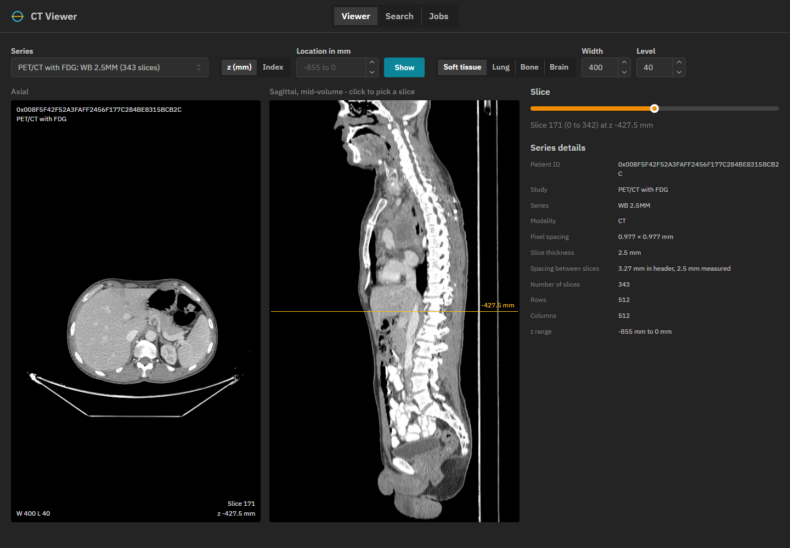

# CT DICOM Viewer

Home assignment for the Python Backend Engineer position, Samueli Integrative Cancer Pioneering Institute.

Index CT DICOM series (one folder at a time or a CSV batch), follow the jobs, query the metadata across studies,
and view any series as an axial slice at a chosen location next to a sagittal view with that location marked.

| Part | Where |
|---|---|
| 1. System design | [`docs/design.md`](docs/design.md) |
| 2. Implementation | [`backend/`](backend) (FastAPI, RQ worker, `schema.sql`), [`frontend/`](frontend) (React + Mantine), [`docker-compose.yml`](docker-compose.yml) |
| 3. Docker and DevOps | [`docs/devops.md`](docs/devops.md) |



## Run it from scratch

Needs only Docker with Compose v2 (Docker Desktop, or Docker Engine 24+).

1. Clone the repository. Download the two sample series (the assignment's shared Google Drive folder,
   "Sample DICOM series for the exam") and extract them into `data/` so that each series is its own top-level
   folder:

   ```
   data/
   ├── 0x23D38C868F3ED85E20/   *.dcm
   └── 0xE13CE7B52F313D3C82/   *.dcm
   ```

   A folder holding both series fails with "Expected one series per directory, found 2"; index each series
   folder instead.

2. Start everything:

   ```bash
   docker compose up --build -d
   ```

3. Open **http://localhost:8080**. On **Jobs**, click **Index** next to each folder, or upload
   [`examples/sample_batch.csv`](examples/sample_batch.csv). Each series takes a few seconds.
   [`examples/batch_with_errors.csv`](examples/batch_with_errors.csv) shows how failed rows are reported.
4. On **Viewer**, pick a series and enter a location in mm or a slice index. Change the window with the presets
   or the width/level fields (default soft tissue, 400/40). **Search** runs queries across studies. The samples
   are 2.0 and 2.5 mm thick, so *thinner than 1.5 mm* correctly finds nothing; try 2.2 mm, or the description
   `chest` (a case-insensitive match on the study or series description).

Stop with `docker compose down`. Add `-v` to also delete the database.
More workers process more series at once: `docker compose up -d --scale worker=6`.

## Why PostgreSQL

Several processes write at the same time (the API creates jobs, every worker saves results), while researchers
query. PostgreSQL handles concurrent writers natively; SQLite serializes all writes and DuckDB allows one writing
process. It also gives arrays (slice positions), `bytea` (the analysis output) and transactions that save a
series and mark its job done together. The schema is [`backend/schema.sql`](backend/schema.sql), loaded by
Postgres when its volume is first created.

**At a million series**, PostgreSQL remains a reasonable metadata index, but stored planes and file arrays
make storage and query measurements essential. What I would change:

* Move the sagittal planes (float32 HU, ~700 KB each, ~700 GB in total) out of the database into object storage (S3/MinIO),
  keeping only the key in the row.
* "Description contains" searches already use `pg_trgm` GIN indexes, and the lists are paged by id (keyset), so
  deep pages avoid scanning and discarding an increasing OFFSET. Filter selectivity still affects latency.
  Elasticsearch/OpenSearch only if search
  grows into free text or facets over many header fields.
* Split studies into their own table and keep extra header fields in an indexed JSONB column, so new query fields
  need no migration. Add automated migration version tracking (for example Alembic) around the existing
  numbered SQL migration approach.
* Partition or archive the `jobs` table by month; put PgBouncer in front and a read replica behind the search page.
* For population-level analytics, export to Parquet nightly and query it with DuckDB.

## How it works

`web` (nginx) serves the React app and forwards `/api` to `api` (FastAPI). Submitting a folder, or each row of a
CSV, inserts a row in `jobs` and a row in `job_outbox` in one transaction. The `relay` publishes due outbox rows
to a Redis queue (and publishes again if a message is lost). An RQ `worker` takes the task, claims the job with a
renewable lease, reads the DICOM
headers, checks the folder holds one series, and sorts the slices by position. It commits the header metadata
before validating viewer geometry and reading pixels to build the sagittal plane
(the "analysis"). A successful analysis saves the headers, the slice file list and the sagittal plane as one
version, together with the job's status. If analysis fails, a new series stays searchable and the viewer shows
that analysis is unavailable. A series that was already analyzed keeps its previous version whole until a
re-analysis succeeds, so a failed or concurrent re-index never pairs new slice files with an old plane. A
problem with the data fails the job at once, with the reason: documents, pictures and system files next to the
slices are skipped, but any other unreadable file, or an image missing its position tags, fails the series and
is named. Database errors, a killed job process and a dead
worker are retried twice before the job fails with the reason. A job that already finished is skipped if it is
delivered again ([design.md, *Durability and failures*](docs/design.md#durability-and-failures)). The viewer reads one DICOM
file per axial image and windows it into a PNG on the server.

The backend has three layers, and each only calls the one below it:

| Layer | Folder | Rule |
|---|---|---|
| API | `backend/api/` | HTTP only: validate input, call one service, return a model or a PNG |
| Logic | `backend/services/` | What the app does; no FastAPI, no SQL |
| Data | `backend/db/` | Every SQL statement; each function is one transaction |

`backend/main.py` is the FastAPI entry point. Shared settings, errors, data types, and logging live in `backend/core/`.

### Code reading order

| File | What it does |
|---|---|
| `backend/schema.sql` | Three tables: `series` (metadata, slice positions, analysis output), `jobs` (status, attempts, lease) and `job_outbox` (dispatch) |
| `backend/services/dicom.py` | Read and validate a folder's headers; HU conversion; sagittal; window/level to PNG |
| `backend/services/ingest.py` | The background job: claim (skips duplicates) → path check → headers → sagittal → save |
| `backend/services/jobs.py` | Submit folders or a CSV; `publish` puts a job ID on RQ (called by the relay) |
| `backend/services/relay.py`, `backend/db/dispatch.py` | Outbox relay: publish committed jobs, recover expired leases |
| `backend/db/repository.py` | All SQL |
| `backend/services/viewer.py` | Closest slice to a location; axial and sagittal PNGs |
| `backend/api/*.py`, `backend/main.py` | Routes, response models, error → HTTP status (`api/errors.py`) |
| `docker-compose.yml` | db, redis, api, worker, relay, web |
| `frontend/src/api.ts` | Typed calls to the API |
| `frontend/src/pages/Viewer.tsx`, `Jobs.tsx`, `Search.tsx` | The three screens |

## API

Interactive documentation: **http://localhost:8080/api/docs**.

| Method and path | Purpose |
|---|---|
| `GET /api/directories` | Folders in the data directory |
| `POST /api/jobs` `{"path": "…"}` | Index one folder |
| `POST /api/batches` (CSV upload) | Index every folder listed in a CSV; one job per row |
| `GET /api/jobs?batch_id=&before_id=&limit=` | Jobs, newest first, with the reason for each failure |
| `GET /api/series?max_slice_thickness=1.5&description=chest&before_id=&limit=` | Query across studies, newest first |
| `GET /api/series/{id}` | Series metadata |
| `GET /api/series/{id}/locate?z=…` or `?index=…`, optional `&v=` | Closest slice to a location in mm, or the slice at an index |
| `GET /api/series/{id}/axial/{index}?window=400&level=40&v=` | Axial slice as PNG |
| `GET /api/series/{id}/sagittal?window=400&level=40&v=` | Mid-volume sagittal as PNG |
| `GET /api/health` | Liveness |

Slice index 0 is the most inferior slice (lowest z). Slices are always ordered by `ImagePositionPatient` z,
never by file name. A location outside the scan shows the nearest slice and says so. *Spacing between slices*
shows the header tag next to the spacing measured from the positions. Many series leave the tag out, and the
PET/CT sample writes 3.27 mm while its slices are 2.5 mm apart.

**Paging:** both lists return `limit` rows (default 100, at most 500). A shorter page is the last one; otherwise
pass the last row's `id` as `before_id` for the next page. The UI's *Load older* buttons do this.

**CSV format:** one folder per row in the first column, relative to `data/`; a first row reading `path` is
skipped. A CSV may hold at most 1 MB and 1,000 data rows (blank rows and the header are not counted). A longer
one is rejected whole with a 422 before any job is created; split it into several files. The limit is per
request: it bounds one transaction and response, not the total number of jobs that many requests can queue.

**Versions (`v`):** `locate`, `axial` and `sagittal` take an optional `v`, the series' `updated_at` as read from
`GET /api/series/{id}`. Indexing a series again changes `updated_at`. A request whose `v` is no longer the
current version gets **409 Conflict** (`Cache-Control: no-store`) instead of data from the newer version, so a
viewer never pairs an old slice list with a new image. The version is compared in the same query that reads the
data. Without `v` the current version is served. The UI sends `v` with every request, and on a 409 it reloads
the series metadata and redraws the viewer for the new version.

**Image limits:** a slice may have at most 2048 × 2048 pixels (`MAX_FRAME_PIXELS`) and 4096 per side, checked from the header before
any pixels are decoded. A PNG drawn to physical proportions may have 1 to 4096 pixels per side
(`MAX_RENDER_SIDE`), checked before it is drawn. Series beyond either limit fail analysis, or get a 422 for the
image, with the reason. Both sample series are 512 × 512, and their sagittal views are 512 × 830 and 512 × 878.

## Development

```bash
cd backend
uv sync                                   # Python 3.13+ and dependencies into .venv
uv run pytest                             # unit tests
TEST_DATABASE_URL=postgresql://postgres:pw@localhost:5432/postgres uv run pytest   # + API tests (drops tables!)
uv run ruff check . && uv run ruff format --check .
uv run uvicorn main:app --reload      # API on :8000 (needs DATABASE_URL, REDIS_URL, DATA_DIR)
uv run rq worker --job-class services.worker.IngestJob  # worker (Linux/macOS; RQ needs fork)
uv run python -m services.relay           # relay: without it jobs stay queued

cd frontend
npm ci && npm run dev                     # UI on http://localhost:5173, forwards /api to :8000
```

| Variable | Default | Meaning |
|---|---|---|
| `DATA_DIR` | `./data` | Host folder with the DICOM series, mounted read-only at `/data` |
| `POSTGRES_PASSWORD` | `ctviewer` | Set it in `.env` before the first start (see `.env.example`) |
| `WEB_PORT` | `8080` | Port of the web app, bound to localhost (the app has no login) |

**Troubleshooting.** On Linux the containers run as uid 10001 and need read access to the data
(`chmod -R a+rX data`). `schema.sql` runs only on an empty database volume: after changing it, recreate the
volume with `docker compose down -v` (this deletes the indexed metadata, not your DICOM files), or apply the
matching file in `backend/migrations/` to keep it.

**Upgrading a database created before float32 sagittal planes.** Sagittal planes used to be stored as int16, which
truncated fractional HU (40.75 became 40). New planes are float32, and each row records its plane's format in
`series.sagittal_encoding`. The new code needs that column, so migrate before starting it, without deleting
the volume:

```bash
docker compose stop worker relay api       # no old worker may write a plane during the change
docker compose exec -T db psql -v ON_ERROR_STOP=1 -U ctviewer -d ctviewer < backend/migrations/001_sagittal_encoding.sql
docker compose up --build -d
```

The migration runs in one transaction and is safe to run again. Existing planes are marked `int16le` and stay
viewable as they are; they are never read as float32. Their lost fractions come back only by indexing those
folders again from the DICOM files (Jobs → Index, or a CSV), which replaces each plane with a float32 one.
Logs: `docker compose logs -f api worker relay`.


### Backend conventions and supported data

Use explicit keyword arguments for application function calls, such as `get_series(series_id=series_id)`.
Keep positional arguments where Python or a third-party API requires them (including the RQ task invocation).
Services use typed records, the HTTP layer uses Pydantic response models, and SQL stays in the repository.
Ruff checks imports, common errors and application function annotations; `ruff format` maintains formatting.
Database failures are retried from PostgreSQL attempt counts; data problems fail the job at once with a readable error.
The API closes its database pool on shutdown.

The current reconstruction supports single-frame MONOCHROME2 CT in standard axial orientation, matching image
sizes and pixel spacing, aligned in-plane origins, and approximately uniform z spacing. It rejects unsupported
geometry with a reason rather than displaying a distorted sagittal reconstruction. Metadata remains searchable.
Non-square pixels are drawn to scale in both views.

Limits to know: indexed files are treated as immutable. The axial view reads them when it is shown, so if files
are replaced in place, re-index the folder (DICOM gives changed instances new UIDs, so this is rare). The sagittal
view is the middle column only, and one analysis result is kept per series (the latest success). Besides DICOM,
a series folder may hold only documents and pictures (`.txt`, `.md`, `.pdf`, `.csv`, `.json`, `.xml`, `.html`,
`.jpg`, `.png`, `.gif`, `.bmp`, `.log`) and system files (dotfiles, `Thumbs.db`, `desktop.ini`); DICOM objects
without pixels, such as a DICOMDIR or a report, are skipped too. Any other file that cannot be read fails the
series, because DICOM slices often have no extension and a truncated one must not shorten the volume silently.
See `docs/design.md` for which parts of the full-service design are implemented.

## How AI was used

I used Claude Code (Anthropic) for planning and implementation, and Codex (OpenAI) for review,
documentation corrections and verification, as the brief allows.

* **Planning:** I worked out the design with it: the Part 1 architecture, the database choice and how Part 2 would
  implement a slice of that design.
* **Implementation:** It wrote most of the code, tests, Dockerfiles and docs from that plan.
* **My direction:** I set the structure and the standards: a three-layer backend (`api/` for HTTP, `services/`
  for the logic, `db/` for all SQL), typed records and Pydantic models at the boundaries, keyword arguments, and
  Ruff for linting and formatting. I also made the scope calls. For example, I removed a working MinIO browser
  upload after checking it against the brief, because Part 2 does not ask for it. It stays in the Part 1 design.
* **Checking:** The retained backend suite passes against a disposable PostgreSQL database (31 parameterized
  cases from 16 test functions); Ruff and the frontend production build also pass. The API tests run jobs in
  the test process, so they do not prove Redis or worker crash recovery. Both supplied series passed header
  and geometry validation, and an indexed sample returned both image views through the running Compose stack.
  A fresh clone of this repository, started with `docker compose up --build`, indexed both samples from
  `examples/sample_batch.csv`, reported the failed rows of `examples/batch_with_errors.csv` with their reasons,
  answered the search queries and served both image views.
