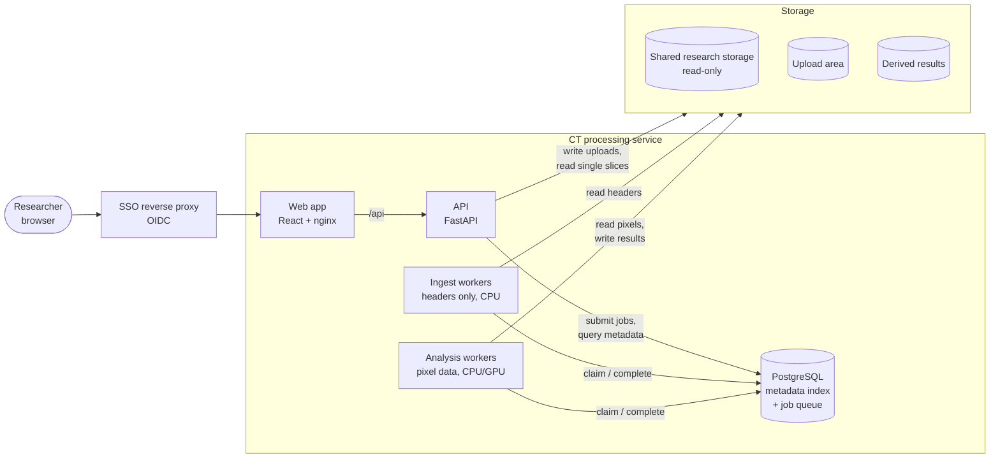
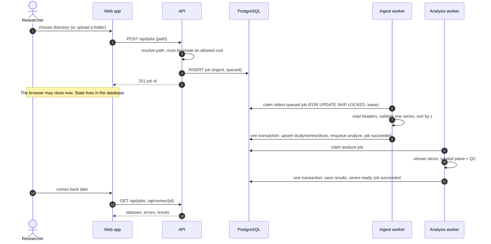
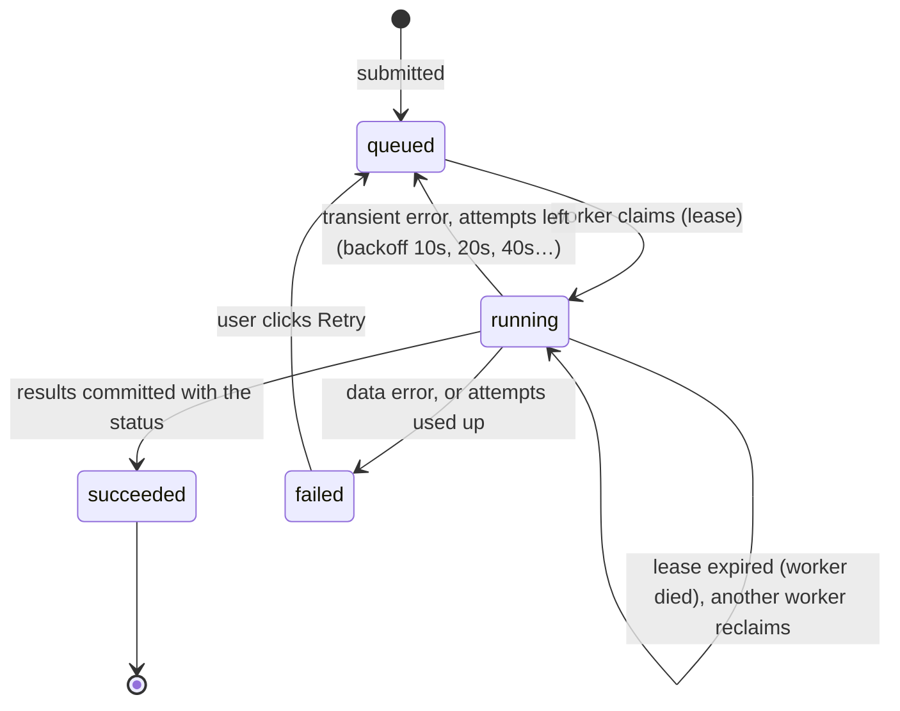
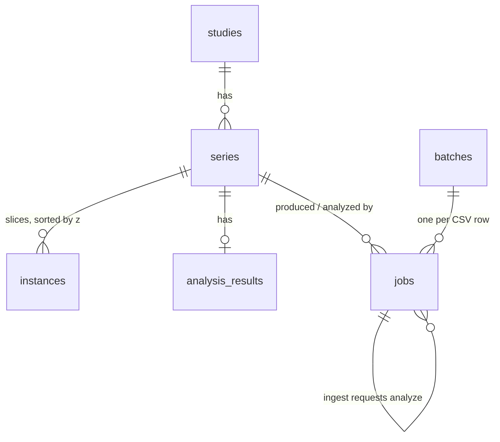

# Part 1 · System design: CT processing service

Researchers upload a CT study (or point at one on shared storage), request processing, and come back later
to see the results and any failures in a web application. The design below is the full service; Part 2 of
this repository implements a working slice of it (see [What the slice implements](#what-part-2-implements)).

## Assumptions

1. **Data.** A study directory holds 200–800 DICOM files (100 MB–1 GB) of exactly one series. The files are
   already anonymized; the `PatientID` we store is a pseudonym. Series are axial CT; other orientations are
   rejected with a clear reason rather than displayed wrongly.
2. **Where the data lives.** The institute keeps imaging data on shared research storage (NAS/NFS). A CSV
   "list of DICOM directory paths" only makes sense if the service can read those paths, so the processing
   nodes mount that storage **read-only**. Researchers can also upload a folder from their own computer
   through the browser; uploads land in a separate area owned by the service.
3. **Users.** Tens of researchers, not thousands. Peak load is a batch of a few hundred to a few thousand
   studies, not a stream of requests. Interactive viewing must feel instant; batch processing may take hours.
4. **Identity.** The institute has single sign-on (OIDC/SAML). An authenticating reverse proxy in front of the
   app passes the user's identity in a header. All researchers in the group may see all indexed series.
5. **Analysis.** "Processing" is a pluggable step (today: viewer artifacts and QC; tomorrow: segmentation or a
   model on a GPU). It can take minutes, can fail, and must not block metadata from being searchable.
6. **Deployment.** On-premises containers (Docker Compose for one host, Kubernetes for several), because the
   data and PHI policies keep it inside the institute. Section [Cloud variant](#cloud-variant) lists what
   changes in a cloud deployment.

## Architecture



| Component | Responsibility | Scales by |
|---|---|---|
| **Web app** | Single-page React app: choose a directory, upload a folder, submit a CSV, watch jobs, search series, view slices. Static files served by nginx, which also proxies `/api`. | Stateless; any number of replicas |
| **API** (FastAPI) | Validates input, creates jobs, answers metadata queries, renders viewer images (one slice → PNG with window/level). Never does long work inside a request. | Stateless; replicas behind the proxy |
| **PostgreSQL** | Source of truth for metadata (studies, series, slices), jobs, batches and analysis results. Also the job queue. | Vertical first; read replicas for heavy querying |
| **Ingest workers** | Read DICOM *headers only*, validate the series, write metadata, then request the analysis. Seconds per study. | Horizontally; bounded by storage I/O |
| **Analysis workers** | One streaming pass over the pixel data: derived images, QC, and in future real models. | Separate pool (GPU nodes if needed) |
| **Storage** | Source data read-only; uploads; derived artifacts (small: previews, masks, reports). | Storage team / object store |

### Why two job kinds

Indexing and analysis have very different costs and failure modes. Reading 800 headers with
`stop_before_pixels` touches a few KB per file and takes seconds, so a study is **searchable almost
immediately**. The pixel pass reads the whole gigabyte and may need a GPU. Splitting them lets each run on its
own worker pool (`WORKER_KINDS=ingest` vs `analyze`), retry independently, and fail independently: a study whose
analysis fails is still indexed and still viewable slice by slice.

## Flows

Every entry point (directory picked in the UI, CSV row, browser upload) becomes the **same `ingest` job**, so
the logic after submission is written once and behaves identically in interactive and batch mode.



**Batch.** `POST /api/batches` with a CSV creates one `batches` row and one `ingest` job **per CSV row**. A row
whose path is invalid (missing, outside the allowed roots) is stored immediately as a *failed* job with the
reason, so the user sees every row's outcome in one table instead of the whole file being rejected. The batch
summary (`ready / failed / pending` per row) is computed from the jobs and the resulting series.

**Upload.** The browser opens an upload session, sends the files in small multipart requests (20 files each,
3 in parallel, so no request is near 1 GB and a failed part is cheap to resend), then calls `complete`, which
creates the same ingest job pointing at the upload directory.

## Jobs



* **Queue on PostgreSQL.** Workers claim with `SELECT … FOR UPDATE SKIP LOCKED`, so any number of them poll
  the same table without taking the same job and without a separate broker.
* **Leases.** A claim sets `locked_until`; a background thread in the worker extends it while the job runs.
  If a worker is killed, the lease expires and another worker reclaims the job. A job that keeps killing its
  worker (for example out of memory) fails with `worker_lost` after `max_attempts`.
* **Exactly one result.** Results and the `succeeded` status are written in **one transaction**, and the
  update only applies if this worker still owns the job. A worker that lost its lease cannot overwrite the
  result of the worker that took over.
* **Idempotent.** Series are keyed on `SeriesInstanceUID`; re-ingesting a directory refreshes the same rows.
  A partial unique index allows at most one active analysis per series.
* **Retry policy.** Errors carry a code and a `retryable` flag. Data problems (`multiple_series`,
  `no_dicom_images`, `duplicate_positions`, `not_axial`, `pixel_decode_failed`…) fail at once, because retrying
  cannot fix the files. Infrastructure problems (`io_error` on network storage, database errors) are retried
  with exponential backoff.

### What the user sees when something fails

| Failure | Detected | Behaviour | User sees |
|---|---|---|---|
| Path missing / outside allowed roots | On submission | 400 for interactive; a failed job for a CSV row | Message next to the form, or the row in the batch's jobs |
| Not a single series, no images, duplicate positions, not axial | Ingest | Fails at once (no retry) | `multiple_series: Expected exactly one series, found 2: …` |
| Corrupt or unsupported pixel data | Analysis | Fails at once; series stays indexed | Series status *analysis failed* with the reason, axial slices still viewable |
| NFS hiccup, database restart | Any | Requeued with backoff, up to `max_attempts` | `io_error … (will retry)`, then success or failure |
| Worker crash / OOM kill | Lease expiry | Reclaimed by another worker; `worker_lost` after repeated crashes | Job keeps its history: attempts, last error |
| Gaps between slices | Ingest | Succeeds with a warning; sagittal interpolates the gap | Warning on the job and the series |

After fixing the data on disk, the user clicks **Retry** on the failed job.

## Data model



* `series` stores the queried fields as typed, indexed columns (slice thickness, modality, spacing, size) and
  the long tail of header fields in a JSONB `attributes` column with a GIN index, so a new question ("all
  series with kernel B30f") needs no migration.
* `instances` stores each slice's file path, z position and instance number in volume order, so the viewer
  opens exactly one file per request.
* Descriptions have trigram (`pg_trgm`) indexes for "contains" search, plus a `lower()` index for exact match.

Typical cross-study queries the API supports (`GET /api/series`):

```sql
-- all series with a slice thickness under 1.5 mm
SELECT … FROM series s JOIN studies st ON st.id = s.study_id WHERE s.slice_thickness < 1.5;
-- all studies with a given description
SELECT … WHERE lower(st.study_description) = lower('CT CHEST W CONTRAST');
```

## Viewer: how a request is served

* **Axial slice.** `locate?z=…` finds the closest slice by binary search over the sorted z positions
  (`ImagePositionPatient[2]`); `axial/{index}` reads that one file, converts to Hounsfield units with
  `RescaleSlope/Intercept`, applies window/level and returns a PNG. About 20 ms; no volume is loaded.
* **Sagittal.** Precomputed by the analysis job: the middle column of every slice, resampled along z to the
  in-plane pixel size so anatomy keeps its true proportions (2.5 mm slices with 0.7 mm pixels would otherwise
  be squashed 3.5×), with gaps interpolated by position rather than by slice count. The API only windows and
  encodes it. The browser draws the location line as an overlay, so moving through slices does not re-fetch
  the sagittal image.

## Storage layout

```
/data/library/…            shared research storage, read-only (CSV paths point here)
/data/uploads/<uuid>/      browser uploads, one directory per upload session
/data/derived/<SeriesUID>/ sagittal.npy (int16 HU), qc.json     ← written by analysis workers
```

Derived files are written to a temporary name and renamed, so a reader never sees half a file. The database
row pointing to them is committed after the file exists.

## Scaling and performance

Measured on the slice (400 slices of 512×512, 200 MB, warm page cache): indexing 0.2 s, analysis 0.9 s,
axial PNG ~20 ms, sagittal PNG ~15 ms. On network storage both jobs are I/O bound: a 1 GB study at
~200 MB/s takes ~5 s to read.

* **Batches of thousands.** Add worker replicas. Throughput is limited by storage bandwidth, so cap analysis
  concurrency per storage system rather than adding workers indefinitely.
* **Fairness.** One user's 5,000-row batch should not starve another user's single interactive request: give
  interactive jobs a higher priority (a `priority` column in the claim's `ORDER BY`), or a dedicated worker.
* **Queue limits.** Postgres as a queue is comfortable up to thousands of jobs per minute. Beyond that, or for
  fan-out to many consumers, move to a broker (RabbitMQ, or SQS in the cloud) and keep Postgres as the record
  of job state.

## Security and privacy

* Data is anonymized upstream; the service still treats it as sensitive: no public exposure, TLS at the proxy,
  storage mounted read-only, containers run as non-root, database not published outside the private network.
* User input never becomes a raw path: paths are resolved (symlinks and `..` included) and must stay inside an
  allowed root, so `../../etc` or a symlink out of the library is rejected.
* Identity comes only from the SSO proxy; the app's own nginx strips any `X-Forwarded-User` sent by a browser.
  Jobs and batches record `submitted_by`, so "my jobs" and audit questions are answerable.

## Observability

* Structured JSON logs (job id, worker id, error code) to stdout, collected by the platform's log shipper.
* `/api/health` (process alive), `/api/ready` (database reachable, volumes mounted) for orchestration.
* `/api/stats`: jobs by status, age of the oldest waiting job, expired leases, failures in the last hour.
  These are the alert signals: *oldest queued job older than N minutes* means workers are down or
  saturated; *failure rate spike* means bad data or a broken dependency.
* Worker liveness: each worker touches a heartbeat file on every loop; the container healthcheck fails if it
  goes stale.

## Trade-offs

| Decision | Chosen | Alternatives | Why |
|---|---|---|---|
| Job queue | PostgreSQL table + `SKIP LOCKED` | Celery + Redis/RabbitMQ, cloud queue | One less system to run and secure; job state and results commit in the same transaction; volume (thousands/day) is far below Postgres limits. Cost: polling (1 s) instead of push, and we own retry logic. |
| Data access | Read in place from mounted storage | Copy every study into object storage | No 1 GB copy per study, and CSV paths work as researchers expect. Cost: workers depend on storage availability, and a file can change after indexing (handled: `source_file_missing`). |
| Pipeline | Separate `ingest` and `analyze` jobs | One job does everything | Metadata searchable in seconds; different hardware per step; independent retries. Cost: two jobs per study to track. |
| Viewer rendering | Server-side window/level to 8-bit PNG | Send raw 16-bit HU to the browser, window in WebGL | Simple and small (~50 KB per slice), works in any browser. Cost: one request per W/L change (debounced). For heavy interactive use, a client-side volume renderer (e.g. Cornerstone3D) is the next step. |
| Sagittal | Precomputed once per series | Computed per request from the volume | A per-request sagittal must read all 800 files (~1 GB). Cost: only the mid-volume plane is available; arbitrary planes would need a stored volume (e.g. a chunked Zarr array). |
| Metadata DB | PostgreSQL | SQLite, DuckDB | Concurrent writers (API + N workers), queue features, JSONB, trigram search, production operations. DuckDB is excellent for analytics exports but is not a concurrent OLTP store. |
| Progress updates | Polling (2 s while jobs are active) | WebSockets / server-sent events | Survives proxies, reconnects and closed tabs with no extra state. Cost: a request every 2 s per open tab. |

## Cloud variant

The same design maps directly: S3 (or MinIO on-prem) for uploads and derived data with **presigned multipart
uploads** so the browser sends bytes straight to storage; SQS or RabbitMQ instead of the Postgres queue at high
volume; managed Postgres (RDS); workers on ECS/Kubernetes with GPU node pools for analysis; secrets from
Secrets Manager / Vault.

## What Part 2 implements

| Design element | In the repository |
|---|---|
| Web app, API, PostgreSQL, workers | Yes: `frontend/`, `backend/app`, `docker-compose.yml` (2 workers by default) |
| Interactive directory selection, browser folder upload, CSV batch | Yes: Import & jobs tab, `/api/jobs`, `/api/uploads`, `/api/batches` |
| Ingest → analysis job chain, leases, retries, per-row batch status, Retry button | Yes: `app/jobs/`, `app/worker.py` |
| Cross-study metadata queries | Yes: Series tab, `GET /api/series` |
| Viewer: closest axial slice by mm or index, sagittal with location line, metadata, window/level | Yes: Viewer tab |
| SSO | Header contract only (`X-Forwarded-User`); the SSO proxy itself is deployment-specific |
| Separate worker pools / GPU analysis | Supported by `WORKER_KINDS`; the compose file runs one pool |
| Object storage, priority scheduling, notifications | Design only |
