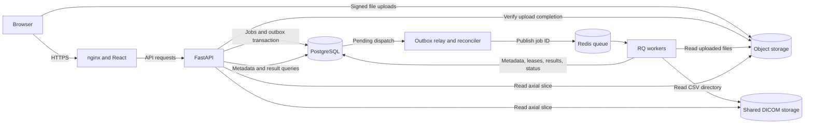
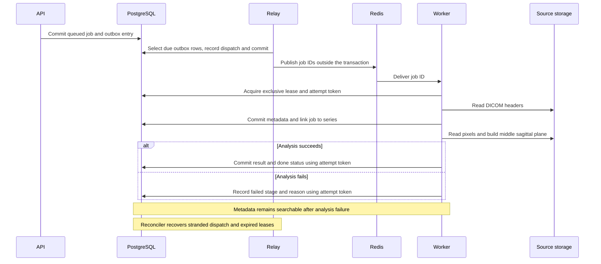

# Part 1 · System design: CT processing service

Researchers upload a CT study, request processing, and return later to view images and query metadata.
This document describes the full service. Part 2 implements a slice of it; the last section lists which parts.

## Assumptions

* Each directory contains exactly one series: 200–800 DICOM files totaling 100 MB–1 GB. Several directories
  may share a StudyInstanceUID.
* Data is anonymized upstream and used for research. Initially, tens of researchers in one trusted research
  group share a catalog, with thousands of series submitted per month.
* The full service uses institutional OpenID Connect login and HTTPS. Part 2 runs locally without login.
* CSV paths refer to an administrator-configured shared data root readable by the service. A remote server
  cannot read arbitrary paths on a researcher's laptop; upload those directories or copy them to shared storage.
* Accepted sources are immutable and retained with results until explicitly deleted. Shared-storage administrators
  must preserve indexed files. PostgreSQL and source storage use persistent storage and backups.
* The initial viewer targets conventional, consistently oriented axial, single-frame CT with matching dimensions
  and approximately uniform spacing. Arbitrary oblique reconstruction and enhanced multi-frame CT are outside
  this implementation slice. Readable metadata can still be indexed when viewer analysis is unsupported.
* The concrete analysis generates a sagittal plane through the middle of the volume. Other analysis tasks can
  later use the same submission and job lifecycle.

## Architecture

| Component | Responsibility |
|---|---|
| React and nginx | Directory upload, CSV submission, job history, search and viewer; one public entry point |
| FastAPI | Submissions, upload verification, metadata/status queries and image rendering |
| PostgreSQL | Durable metadata, job history, upload sessions, processing leases and dispatch outbox |
| Outbox relay and reconciler | Publish committed jobs and recover stranded work after outages |
| Redis and RQ workers | Execute slow processing outside HTTP requests; read headers and pixels, generate results |
| Object/shared storage | Retain original DICOM files for workers and image endpoints |

## Submission and processing flows

### Interactive upload

1. The researcher selects a local directory. `POST /api/uploads` creates a durable upload session containing an
   expected file manifest (relative names, sizes and checksums), and returns short-lived signed upload URLs.
2. The browser uploads directly to an isolated object-storage prefix. Persisted per-file completion and multipart
   state support retries. Returning to an incomplete upload may require reselecting the local directory.
3. The researcher requests processing through `POST /api/uploads/{id}/complete`. The API verifies manifest entries,
   sizes and checksums, then seals the source against modification. Partial uploads never enter processing.
   Incomplete sessions expire after 24 hours; cleanup removes their unreferenced objects.
4. Completion creates a job and outbox entry in one transaction. Repeated completion returns the same job.
   Acceptance is acknowledged only after commit. Closing the browser after acceptance cannot cancel processing.

### Shared directory and CSV

`POST /api/jobs` accepts a directory under the shared data root. The Part 2 UI lists these directories.
`POST /api/batches` accepts a UTF-8 CSV: the first column is a path, an optional `path` header is skipped, and blank
rows are ignored. A CSV holds at most 1,000 data rows; a longer one is rejected whole, while it is read and
before anything is written. That limit bounds one request, not the total queue. Each nonblank data row creates an
independent job and outbox entry, sharing a `batch_id` and
retaining its CSV row number. An invalid directory fails its own job while other rows continue.

Relative paths resolve under the configured root; absolute paths must also resolve inside it. Paths on another
machine are not upload instructions. Both routes resolve to a source reference (shared directory or sealed object
prefix) and invoke the same pipeline.

### Common pipeline

Header extraction and viewer geometry validation are separate steps. The worker saves the metadata as soon as it
knows the folder holds a single series, before decoding any pixels, because a series with odd geometry is still
worth finding in a search. Missing optional tags are stored as null. Unreadable headers or mixed series are an
ingestion failure, since there is no reliable metadata to save. Unsupported geometry or corrupt pixels are an
analysis failure, and the series stays searchable.

## Data model and interfaces

* `series`: unique SeriesInstanceUID, StudyInstanceUID, anonymized patient ID, study and series descriptions,
  modality, pixel spacing, slice thickness, header spacing between slices, measured spacing, slice count, rows
  and columns, plus the ordered z positions and slice file references. Upserts avoid duplicate metadata
  for repeated submissions of the same immutable series. A series can exist without a successful analysis.
* `jobs`: source reference, batch ID, CSV row number, series link, status (`queued`, `running`, `done`, `failed`),
  processing stage, attempt count, error reason, timestamps, lease expiry and attempt token.
* `results`: successful job/series link and sagittal plane, initially as PostgreSQL `bytea` with dimensions and
  value format. The result and its job's `done` status commit in one transaction, so a job is never done without
  its result. Later failed jobs do not erase results.
* `upload_sessions`: manifest, object prefix, progress, expiry and accepted job link.
* `job_outbox`: publication requests committed with jobs; publication can safely repeat.

Study fields initially live on the series row. One series per directory does not imply one series per study:
study-level searches deduplicate by StudyInstanceUID. A thickness query uses `slice_thickness < 1.5`, excluding
unknown values. A study-description filter searches StudyDescription; general description search may include
both descriptions. Thickness and study UID are indexed, and the catalog and job history are paged so old results
remain reachable.

The full service keeps the Part 2 API: `POST /api/jobs`, `POST /api/batches`, `GET /api/jobs`, `GET /api/series`,
`GET /api/series/{id}`, and the series `/locate`, `/axial/{index}` and `/sagittal` endpoints. Upload sessions are
the only new resource. Series responses expose analysis availability; image endpoints use the latest successful
result by completion time, or report that analysis is unavailable. Job history retains individual result links.
The browser polls pending work and reloads durable history on return.

## Part 2 viewer behavior

* Slices are sorted by ImagePositionPatient z, never by file name, because file names and InstanceNumber are not
  guaranteed to follow anatomy. Index 0 is the lowest z.
* The user gives either z in millimetres or a zero-based index. The nearest z wins, and a tie picks the lower
  index. A z outside the scan shows the nearest end slice and says so; an invalid index is rejected.
* The axial slice is decoded and converted to Hounsfield units (the modality transform) before windowing. The
  sagittal plane is the middle column (`columns // 2`) of every slice, which is exact under the geometry
  assumptions above.
* Superior slices are at the top of the sagittal image, and a horizontal line through the selected slice's row
  marks it, labelled with the actual z. Proportions follow the physical spacing. Irregular geometry would need
  resampling, so it is rejected with a reason instead of being drawn distorted.
* The metadata table shows all ten required entries: patient ID, study description, series description,
  modality, pixel spacing, slice thickness, spacing between slices, number of slices, rows and columns. Spacing
  measured from the positions is shown next to the header value when the tag is missing or disagrees.
* The window defaults to width 400 and level 40, the width must be positive, and a change applies to both views.
  The analysis stores Hounsfield values as float32, keeping fractional values from RescaleSlope/Intercept as
  the axial view does, not a windowed image, so changing the window only re-renders PNGs. Each plane records its
  encoding; planes written as int16 by earlier versions stay readable after `backend/migrations/001`.
* Location and image requests name the metadata version they were built from (`v` = `updated_at`). After a
  re-index, a stale request gets 409 and the viewer reloads the series instead of mixing versions.
* Header sizes are bounded before allocation: at most 2048 × 2048 pixels per decoded slice, and 1 to 4096
  pixels per side of a rendered PNG. Larger or degenerate sizes are rejected with a reason.

Part 2 now validates standard axial orientation, matching dimensions and pixel spacing, aligned in-plane origins,
and approximately uniform z spacing before analysis. It rejects unsupported geometry with a reason while retaining
readable metadata. It does not perform general DICOM reconstruction or resample irregular positions.

## Durability and failures

PostgreSQL is the source of truth and queue delivery is at least once. The full-service contract below requires
application recovery logic in addition to RQ:

* **Dispatch:** the relay marks a batch of committed outbox entries published, commits, then publishes them, so no
  database lock waits on Redis. A queue outage returns the batch to the outbox; a relay crash between commit and
  publication delays dispatch until the next republish. The reconciler also republishes jobs still queued
  without progress, covering loss of an already-published queue message.
* **Exclusive execution:** atomically acquire a renewable lease with a new attempt token. A live lease prevents
  another delivery from claiming that job. Every metadata, result and status write checks the token and valid
  lease; stale workers cannot commit. Workers stop on renewal failure. Lease expiry can briefly overlap physical
  execution, but only the current attempt may publish changes.
* **Retries:** permanent input errors fail immediately. Transient database/storage errors and interrupted attempts
  retry with backoff, up to three processing attempts, with a 30-minute deadline per attempt. The cooperative
  deadline check stops processing shortly before that deadline and records a terminal timeout failure. If a
  blocked decoder or a killed process prevents that check, lease recovery treats the attempt as interrupted
  and may retry it within the same attempt budget. Waiting for queue
  availability consumes no attempt. PostgreSQL stores attempt counts; reconciliation owns retry dispatch so
  independent queue retries cannot reset the budget.
* **Worker interruption:** expired leases are retried or marked failed after the attempt budget. Completed jobs
  are skipped on redelivery. Separate submissions for the same immutable series may run independently; metadata
  upserts are idempotent and each result belongs to its job.
* **Database outage during failure reporting:** callbacks cannot persist while PostgreSQL is unavailable. Once it
  returns, reconciliation finds expired leases and retries or records an interruption failure. Preserve a specific
  cause if available; otherwise state that the worker stopped and the original cause was not recorded.
* **Visible errors:** the job stores the failed stage and a readable reason, such as "Directory not found",
  "Expected one series, found 2", or "Pixel decoding failed". Stack traces go to protected logs, tagged with the job
  ID, because they can contain paths and header values that users should not see. Analysis
  failure retains metadata. Terminal outcomes remain visible after browser closure and service restart.

## Choices and trade-offs

| Choice | Rationale and cost |
|---|---|
| PostgreSQL | API and workers write concurrently while researchers query. Transactions, indexes, arrays and binary values fit the workload. SQLite simplifies local deployment but serializes writes; DuckDB suits analytics better than this multi-process transactional service. |
| Redis and RQ with durable dispatch | Keeps processing outside requests and provides process supervision. Outbox, leases and reconciliation add recovery complexity. A PostgreSQL queue could remove Redis but still needs execution supervision and recovery. |
| Direct uploads plus shared paths | Uploads support laptop directories without routing up to 1 GB through the API. Shared paths avoid copying existing institutional data. Two source adapters are needed, and shared-file retention is an operational dependency. |
| Metadata commit before analysis | Failed analysis remains searchable and retryable. Schema and UI must represent metadata without images. |
| Precompute sagittal values | Reads the series once per job and makes viewing cheaper, at the cost of stored output and initial processing time. |
| Small results in PostgreSQL | Result and completion commit atomically. Large or numerous outputs eventually need object storage and cleanup of unreferenced results. |
| Server-rendered PNG | Avoids sending the entire volume to the browser. Window changes require requests and server work; latency must be measured. |

Workers scale independently of the API, and each runs one job at a time, which bounds disk bandwidth and memory
per worker. The sagittal algorithm
retains headers, one decoded slice and the output plane rather than the entire volume; actual memory depends on
image dimensions and decoder buffers. API replicas share persistent storage and PostgreSQL.

At a million series, results would move to object storage (substring searches already have trigram indexes), and job
history would be archived or partitioned (pagination is already keyset). Studies would get their own table if
repeated fields become costly, the existing numbered migrations would gain automated version tracking, and replicas or a search service would come only
after measurements show the need. The
[README](../README.md#why-postgresql) contains the database rationale and scaling discussion required by Part 2.

## Security and operations

The full service uses institutional SSO, accepting identity headers only from a trusted proxy. The initial group
shares access; separate groups would require authorization on metadata, jobs, sources and results. Signed URLs
are scoped to one upload session. Sealing copies specific object versions into a worker-readable prefix that upload
credentials cannot write to and verifies the sealed copies against the manifest before accepting the job. This
prevents an overwrite during verification from changing the accepted source. Manifest paths are
validated, and file counts and total bytes are bounded.

Shared paths are resolved, symlinks included, and must stay inside the data root, which is mounted read-only.
In production, containers would run as non-root, secrets would come from a secret manager, and traffic would use
TLS. Application logs should avoid patient metadata and pixels; exception traces can still contain paths or
header values, so access and retention must be restricted. Logs and backups are protected as research data. Restores of both PostgreSQL and the
source files are tested, since a backup that was never restored is not known to work.

Monitoring covers API errors and latency, the oldest pending outbox entry, the oldest queued job, expired leases,
failures by stage, worker availability and storage capacity, with an alert when reconciliation stops making
progress. `/api/health` provides
liveness; deployment readiness checks required dependencies. See [devops.md](devops.md) for existing deployment
notes; relay, lease and upload monitoring described here are target additions.

## Requirement review and acceptance scenarios

| Requirement or scenario | Expected outcome in the full service |
|---|---|
| Upload 200–800 files, 100 MB–1 GB | Retain and verify files before accepting processing; incomplete uploads resume or expire |
| Interactive submission and CSV containing valid and invalid paths | Same pipeline; independent durable outcome per CSV data row |
| Thickness below 1.5 mm or given study description | Query indexed metadata, including series whose later analysis failed |
| Close browser after acceptance and return | Processing continues; history and results are retrievable |
| Pixel decoding fails after header extraction | Metadata remains searchable; job shows analysis failure and reason |
| Queue outage or API crash after submission commit | Durable dispatch eventually resumes without losing the accepted job |
| Worker interruption or duplicate delivery | Bounded recovery; stale attempts cannot commit and completed jobs stay completed |
| Database unavailable during failure reporting | Reconciliation retries or records an outcome; missing original cause is stated honestly |
| Select z/index and adjust window/level | Nearest axial image, matching sagittal marker, required metadata, default 400/40 and adjustable windowing |

## Current Part 2 implementation boundary

This inventory describes the current implementation. Part 2 reads series from the mounted data folder only. Browser upload to object storage is part of the target
design above, not of the implementation.

| Capability | Current implementation and remaining work |
|---|---|
| Interactive and CSV submission | Mounted folders under `data/`; CSV jobs share a batch ID, but source row numbers are not stored |
| Browser upload | Not implemented: the Part 2 brief only needs a chosen DICOM directory, which the app takes from the mounted `data/` folder. Direct upload to object storage, verification and sealing stay in the target design |
| Metadata queries | Thickness and combined description filters exist, paged newest first by id (keyset, up to 500 per page); explicit study-only/deduplicated search remains an addition |
| Metadata before analysis | Implemented for new series: headers commit before geometry validation and analysis; output is nullable and the UI displays metadata-only entries. An analyzed series keeps its previous version searchable until a re-analysis succeeds |
| Job history and errors | Stored in PostgreSQL with stage and attempt count; paged newest first and filterable by CSV batch, so every row's outcome stays reachable |
| Dispatch/recovery | Implemented: `job_outbox` rows commit with jobs; `python -m app.relay` publishes due rows, republishes queued jobs without progress, and recovers expired leases or attempts past the 30-minute timeout |
| Retries and duplicate protection | Implemented: workers claim a job with a new attempt token and a renewed lease; metadata, result and status writes check both. Retryable database errors back off up to three attempts; RQ retries are not used |
| Results | One sagittal plane lives on the series row. A successful analysis replaces headers, slice files and plane in one transaction (latest success wins), so failed or concurrent re-indexing never mixes versions; job-specific result records are a target addition |
| Viewer | z/index, axial and sagittal views, marker, metadata and adjustable 400/40 windowing exist; geometry validation rejects unsupported orientations and irregular spacing |
| Database deliverables | `backend/schema.sql` contains the schema; README contains the PostgreSQL rationale and million-series changes |
| Production operations | SSO, TLS, readiness checks and relay/lease/upload monitoring are design capabilities, not local-app features |

The remaining gaps (browser upload, CSV row numbers, job-specific results, study-level search, operations) do not
change the architecture; each is an addition to the existing tables and endpoints.

### Automated tests

The backend suite is deliberately small: 15 tests, one per behavior the brief or a past bug made important.

| Level | What it checks |
|---|---|
| Unit (`test_dicom.py`, `test_services.py`) | Slices sorted by z, not file name; the sagittal plane takes the middle column of every slice in z order; window/level maps level ± width/2 to black and white; nearest slice for a z (ties pick the lower index, ends clamp) or an index, and invalid requests rejected; CSV first column, optional header, blank rows and the 1,000-row limit; concurrent first requests build one connection pool |
| API on a disposable PostgreSQL (`test_api.py`) | Index, search by thickness and description, locate, and both PNGs; each CSV row fails on its own with its reason; metadata stays searchable when analysis fails; a request naming a replaced version gets 409, not a mix of versions; fractional HU are stored as float32 and window like the axial slice; an expired attempt cannot write after recovery; the migration keeps int16 planes readable |

The API tests run each job in the test process, with no Redis or worker; they skip unless `TEST_DATABASE_URL` is
set, because they drop and recreate the tables. Queue outages, relay crash recovery, retry limits, duplicate
claims and the browser's reload after a 409 are designed and implemented as described above, but have no
automated tests.
